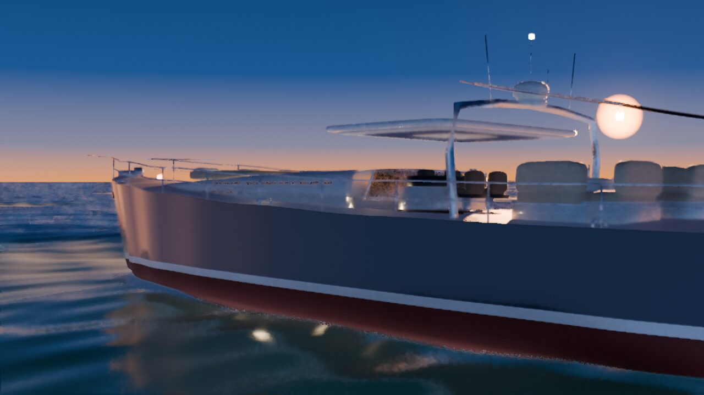
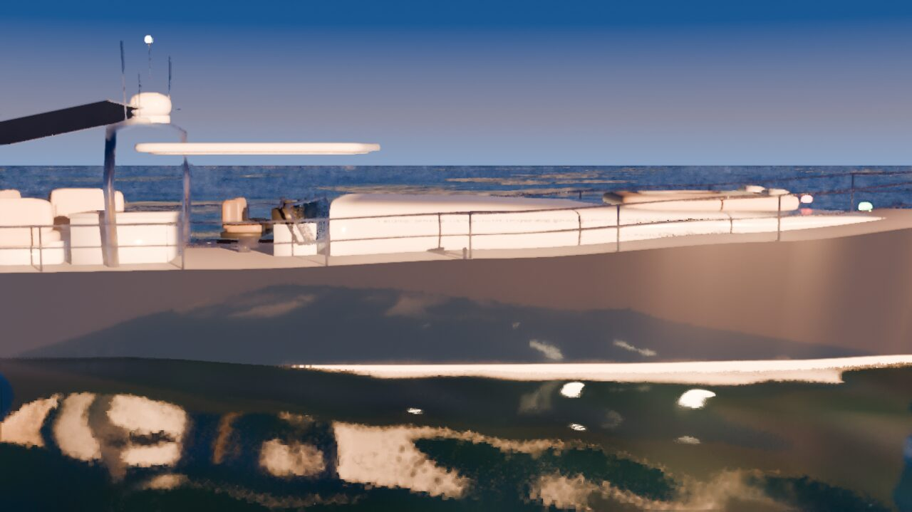
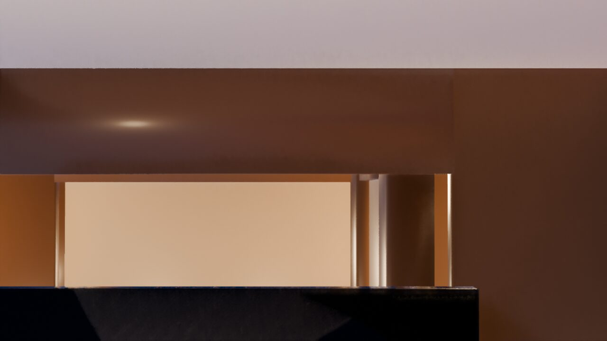
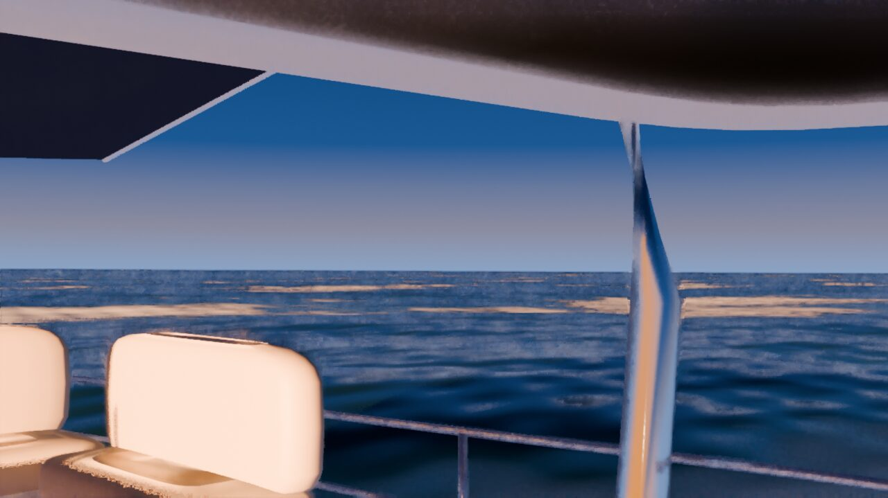
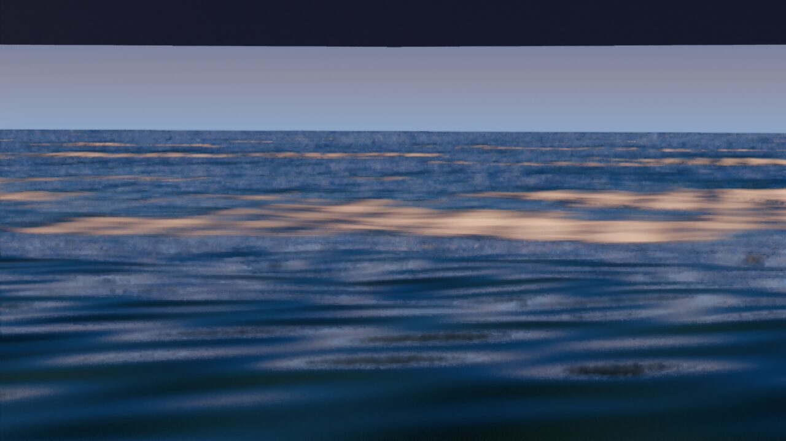
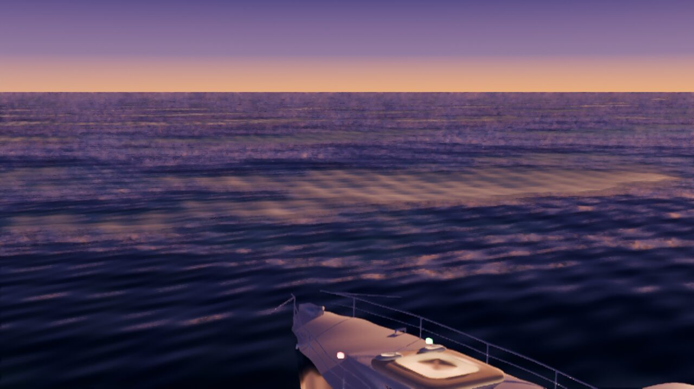
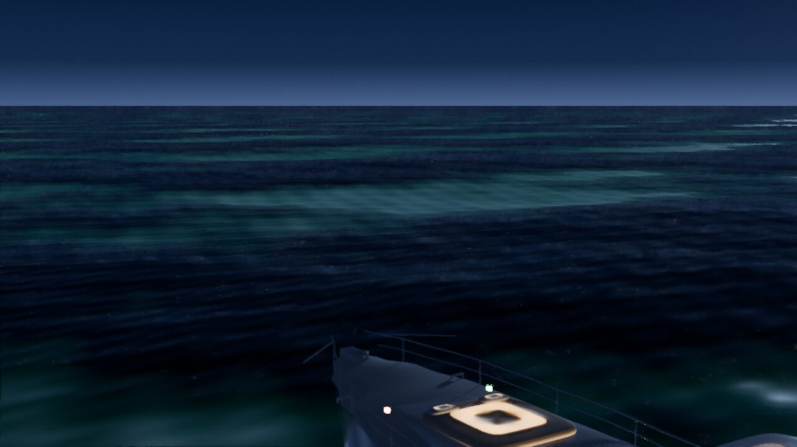

# Yacht demo

A 22 m motor yacht at sea, built entirely over nREPL with upbge-jolt from the
brief in [`../PROMPT.md`](../PROMPT.md). You can walk the decks and the
interior, take the helm and drive, and change the time of day.



| | |
|---|---|
|  |  |
|  |  |
|  |  |

## Files

- `yacht.blend`: the built scene, with the game logic stored in it as the
  Text `main.clj`.
- `build.clj` (ns `yacht-build`): the ocean, sky, sun, cameras, worlds and
  render settings.
- `yacht.clj` (ns `yacht`): the yacht: lofted hull, deck, superstructure,
  interior, materials.
- `main.clj` (ns `yacht-main`): the game: walking, driving, buoyancy, cameras,
  HUD, audio, time of day.
- `PROGRESS.md`: the build log, known problems and what's left.
- `shots/`: the stills above.

## Run it

Build the engine and runtime first (see
[docs/getting-started.md](../../docs/getting-started.md)):

```
jolt upbge-deps && host/integrate.sh && jolt lib
```

Then, from the repo root:

```
host/play.sh $PWD/example/yacht/yacht.blend
```

The game opens with an intro flyover. Press any key to board. Click in the
window to capture the mouse for looking around.

| Key | Action |
|---|---|
| W A S D | walk, or throttle and steer at the helm |
| Shift | run |
| Mouse | look |
| E | take or leave the helm, open doors |
| C | helm or chase camera while driving |
| O | photo mode (free fly) |
| T | cycle time of day |
| H | hide the HUD |
| P | screenshot to `~/yacht-<time>.png` |
| F1 | controls panel |
| Esc | release the mouse |

The nREPL server stays up while the game runs, so you can connect to
`.nrepl-port` and change handlers live, for example
`(game/errors)` or `(:fps (bge/frame-info))`.

It ran at about 40 fps at 720p on the Mac it was built on. The ocean shader
is the main cost.

### Standalone app

```
host/release.sh example/yacht/yacht.blend "Yacht"
```

This writes `release/Yacht.app` and `release/Yacht.zip`, which contain the
player, the jolt runtime and the scene, and need nothing else installed.
Packaging is macOS only for now.

## Edit it

Open the scene in the editor and connect over nREPL:

```
host/run.sh editor $PWD/example/yacht/yacht.blend
```

```clojure
(require '[upbge-jolt.bpy :as bpy] '[upbge-jolt.bridge :as b]
         '[upbge-jolt.nodes :as nodes] '[upbge-jolt.game :as game]
         '[upbge-jolt.bge :as bge] '[upbge-jolt.audio :as audio])
(game/start!)     ; play in the viewport; Esc or (game/stop!) to end
```

After changing `main.clj`, store it in the scene and save:

```clojure
(game/set-main-file! "/abs/path/example/yacht/main.clj")
(bpy/save! "/abs/path/example/yacht/yacht.blend")
```

## Rebuild it from source

The .blend is generated by the two build files, so you can rebuild it from
an empty scene. Start a fresh editor (no file argument), connect, and
evaluate:

```clojure
(load-file "/abs/path/example/yacht/build.clj")
(load-file "/abs/path/example/yacht/yacht.clj")
(yacht-build/build!)    ; sea, sky, sun, cameras, worlds
(yacht/build!)          ; the yacht; deletes and recreates all Y-* objects
(yacht-build/tune!)     ; play render settings and ocean tuning
(game/set-main-file! "/abs/path/example/yacht/main.clj")
(bpy/save! "/abs/path/example/yacht/yacht.blend")
```

The full build takes a minute or two. If your nREPL client has a short
request timeout, evaluate the three build calls one at a time. Then play the
result with `host/play.sh` as above.

## Reproduce it with an agent

The scene was made by an LLM coding agent (opencode with DeepSeek) working
from `../PROMPT.md` over nREPL, with the
[upbge-jolt skill](../../skills/upbge-jolt/SKILL.md) installed, across
several resumed sessions. To try it yourself:

1. Copy `skills/upbge-jolt/SKILL.md` to your agent's skills directory.
2. Start an editor with `host/run.sh editor`. Clients that read
   `.nrepl-port` connect without being given the port.
3. Give the agent `example/PROMPT.md` and tell it to keep `PROGRESS.md`
   beside its scene, so later sessions can resume where the last one
   stopped.

The results will differ from run to run. This directory is one of them.
